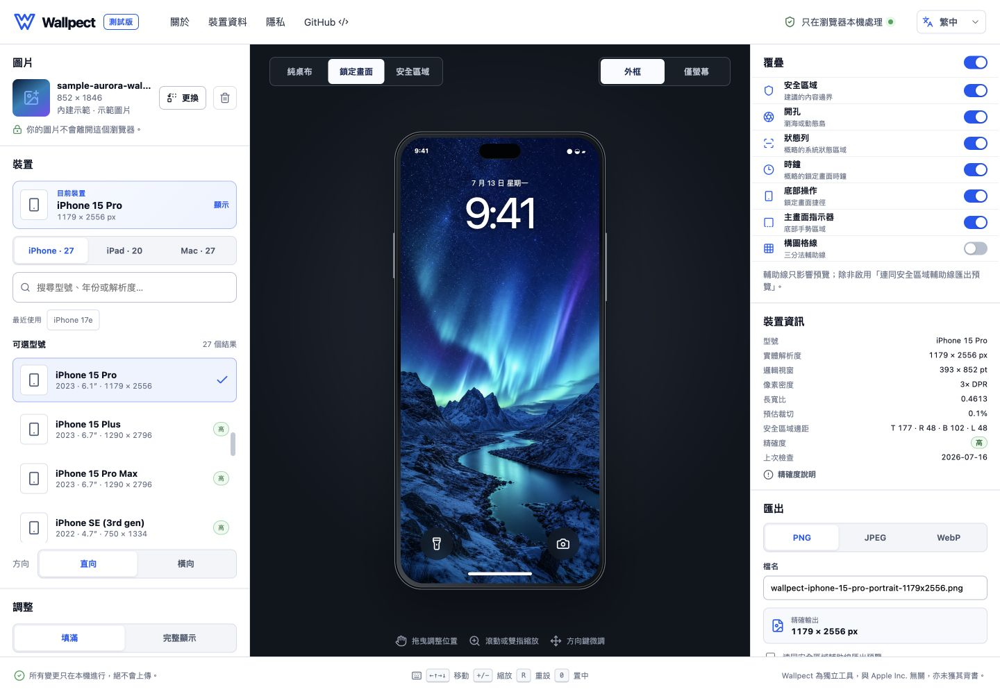
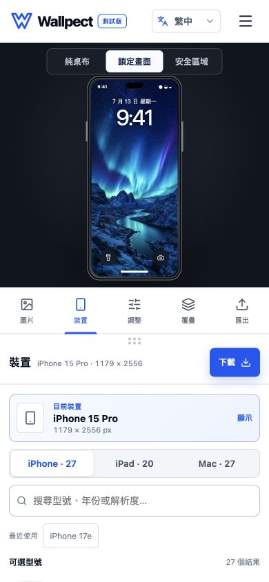

<div align="center">

# Wallpect

**以私隱為先的 Apple 裝置桌布預覽與適配工具。**

[立即使用](https://wallpect.k-y.cc) · [English](README.md) · [技術文件](#技術文件)

[](https://github.com/kyeunga25/wallpect/actions/workflows/ci.yml)
[](https://github.com/kyeunga25/wallpect/releases/latest)
[](LICENSE)
[](https://wallpect.k-y.cc)

</div>



Wallpect 讓你按所選 Apple 裝置調整圖片構圖、檢查可能遮擋內容的系統介面，並以設定檔的精確像素尺寸匯出桌布。正式版本以純 Static Assets 模式部署在 Cloudflare Workers。圖片解碼、編輯、預覽及匯出全部在瀏覽器內完成；沒有圖片上傳端點、帳戶系統、資料庫或第三方圖片分析。

## 可以做甚麼

| 檢查                                                         | 構圖                                               | 匯出                                               |
| ------------------------------------------------------------ | -------------------------------------------------- | -------------------------------------------------- |
| 檢查長寬比、開孔、安全區域、鎖定畫面、選單列及 Dock 輔助線。 | 拖曳、縮放、平移、旋轉、填滿、完整顯示或延伸圖片。 | 按所選設定檔的實體像素尺寸下載 PNG、JPEG 或 WebP。 |

### 主要功能

- 47 個不重複的畫布配置：19 個 iPhone、11 個 iPad、17 個 Mac／Apple 顯示器配置，共覆蓋 191 個 2007–2026 年具名型號
- 相同 wallpaper 畫布及遮擋幾何的裝置共用一個選項；可直接跨 iPhone、iPad、Mac 分類搜尋所有型號名稱、年份、吋數及解析度
- 桌面版選定裝置後會收起完整裝置瀏覽器，讓構圖控制維持在順手位置；流動版裝置分頁則繼續顯示完整可搜尋目錄
- 在本機解碼 PNG、JPEG 與 WebP，限制為 30 MB、最長邊 12,000 px 及 7,200 萬像素
- 內建示範圖是合成的項目素材，並保留內容真實性 provenance；當中不含 Apple 產品素材或使用者圖片
- 圖片卡直接顯示目前本機圖片的縮圖；更換圖片會清空所有裝置及方向的舊構圖歷史，避免意外沿用上一張圖的位置
- 每部裝置分別保存直向及橫向構圖
- 每個裝置與方向各自提供復原／重做歷史，並支援合併連續手勢、鍵盤快捷鍵及 1 px 位置微調
- 首屏提供快速定位，可一按置中，或按目前畫布的 10% 上下左右移動，毋須先理解 X/Y 數值
- 圖片有可用裁切空間時會顯示「內容定位」，可一按展示左／中／右或上／中／下內容；適合把人物、標誌或文字帶回畫面，毋須反覆拖曳，而且每次定位均可復原
- 「精確微調」收合區會持續顯示目前數值，並保留精確 X/Y、1 px 微調及旋轉，避免日常調整流程過度擁擠
- 縮放、旋轉及匯出品質滑桿會按真實數值填色，並向輔助技術提供相同且帶單位的數值
- 一按比較原始構圖，不會取代編輯數值或影響匯出結果
- 桌面與手機均可進入專注預覽，暫時隱藏編輯面板而不改變構圖
- 可直接在預覽上一按切換直向及橫向，包括保持手機「調整」分頁或專注預覽期間
- 切換模式專屬的輔助線時，會自動開啟相應的鎖定畫面／桌面或安全區域預覽，讓每次變更即時可見；構圖格線及裝置開孔則不會強制改變模式
- 手機可用「更多控制／更多預覽」平衡長編輯面板與即時預覽，並支援 320px 寬的小螢幕
- 手機預設直接顯示「調整」；選好本機圖片或裝置後亦會自動返回調整，減少在長目錄與編輯控制之間重複切換
- 桌面與手機「調整」面板會先顯示裁切程度、原圖像素是否足夠及容易理解的構圖建議；重要內容被大量裁切時，可按「顯示整張圖片」重設縮放、位置及旋轉，或使用內容定位選擇要展示的部分，而且仍可復原；純色、透明及模糊延伸背景保持在相鄰流程，方便立即處理留白
- 桌面版在常見 MacBook 高度把精確輸出及下載保持在首屏；格式、檔名與輔助線仍可從「匯出設定」展開
- 純色、透明或模糊延伸背景
- 預覽與匯出共用相同的變換及 Canvas 渲染計算
- 響應式桌面與流動版工作區
- 預設繁體中文，並支援簡體中文及英文
- 首次載入正式版本後可離線快取應用程式外殼
- 清楚標示公開、推算及估算裝置資料的準確度

## 立即試用

1. 開啟 [wallpect.k-y.cc](https://wallpect.k-y.cc)。
2. 使用內建示範圖片，或從裝置選擇圖片；圖片卡的縮圖會確認目前正在編輯哪一張圖。換成另一張圖片時，Wallpect 會開始全新的構圖，不會沿用上一張圖片的偏移或復原歷史。
3. 選擇裝置設定檔及方向；桌面版可隨時按「更換」重新開啟完整裝置瀏覽器。手機選好圖片或裝置後會返回「調整」，亦可直接按預覽上的旋轉操作切換方向，毋須離開目前編輯畫面。
4. 在「調整」開首的「構圖概況」確認目前裁切程度及估算放大倍率；重要內容被大量裁切時，可按「顯示整張圖片」自動完整顯示，或用「內容定位」一按展示圖片的左／中／右或上／中／下部分。兩種操作都可復原，且只使用尺寸與共用渲染幾何，不會分析圖片。再從相鄰的純色、透明或模糊延伸處理留白。如要自行構圖，可用「快速定位」一按置中或按畫布的 10% 移動；需要更高精度時展開「精確微調」使用 X/Y、1 px 微調及旋轉，收合時仍可看到目前數值。拖曳及復原／重做保持直接可用。手機遇到較長面板時可按「更多控制」，也可比較原始構圖或進入專注預覽放大檢查。
5. 在「覆疊」調整安全區域、鎖定畫面、選單列或 Dock 輔助線時，Wallpect 會自動開啟相應預覽模式，讓你立即看到結果；構圖格線及裝置開孔會保留目前模式。
6. 直接按精確輸出下方的「下載桌布」便會使用目前格式；如需 JPEG、WebP、自訂檔名或輔助線，先展開「匯出設定」。

圖片及其縮圖只會保存在瀏覽器記憶體，當圖片被取代、移除、頁面重新整理或關閉時便會釋放。放大倍率只由圖片尺寸、所選畫布及共用渲染幾何計算，不會分析或傳送圖片像素。只有介面語言（`wallpect:locale:v1`）及最多四個最近使用的裝置識別碼（`wallpect:recent-devices:v1`）會儲存在版本化 `localStorage`；公開網站檔案的正常請求仍會經過 Cloudflare，但不包含你選擇的圖片 bytes。

網站內可直接查閱繁中／英文的私隱、使用條款、免責及資料來源說明。維護與新增第三方來源／API 的規則記錄於 [條款、私隱與資料政策](docs/LEGAL_PRIVACY_AND_DATA_POLICY.md)。

<p align="center">
  
</p>

## 準確度原則

Wallpect 將公開的顯示資料與需要量度或推算的幾何資料分開處理：

- 所選設定檔決定匯出像素尺寸及長寬比。
- 裝置外框及系統覆疊只是構圖輔助線，並非 Apple 官方渲染畫面。
- 每個設定檔均標示準確度；初始資料集刻意標記為 `high` 而非 `verified`，因為大部分遮擋幾何均為推算值。
- iOS、iPadOS 及 macOS 仍可能套用系統層級的縮放、延伸、景深或填滿行為。

完整定義及資料問題回報要求請參閱[準確度政策](docs/ACCURACY_POLICY.md)。

## 技術棧

| 層面           | 技術                                                  | 用途                                      |
| -------------- | ----------------------------------------------------- | ----------------------------------------- |
| 介面與應用程式 | React 19、strict TypeScript 5、Vite 8                 | 編譯成靜態資源、具型別檢查的單頁應用程式  |
| 瀏覽器圖片處理 | Canvas 2D、File／Blob API、Object URL                 | 在本機解碼、構圖、預覽及匯出              |
| 介面圖示       | Lucide React                                          | 開源介面圖示                              |
| 託管           | Cloudflare Workers Static Assets、Wrangler 4          | 純靜態邊緣傳送、SPA fallback、預覽及部署  |
| 離線 app shell | Service Worker、Cache Storage                         | 首次連線載入後提供同源 app shell fallback |
| 品質檢查       | ESLint、Prettier、Vitest、Testing Library、Playwright | 靜態、單元、整合及瀏覽器測試              |
| 自動化         | GitHub Actions、Cloudflare Workers Builds             | 唯讀 CI 檢查、分支預覽及正式 build        |

目前部署不包含 SSR、Worker request handler、runtime API、身份驗證、分析服務、資料庫、物件儲存 binding 或執行時 AI 模型。精確依賴版本鎖定在 [`package-lock.json`](package-lock.json)，而 [`package.json`](package.json) 是 scripts 及直接依賴的可讀來源。

## 本機開發

需求：Node.js 22 或更新版本，以及 npm。

```bash
git clone https://github.com/kyeunga25/wallpect.git
cd wallpect
npm ci
npm run dev
```

執行主要品質檢查；`npm run check` 包括 lint、單元／整合測試、strict production build 及 raw build size budget：

```bash
npm run check
npm run format:check
npm run worker:check
```

Playwright 會先 build，再在 `4174` 啟動 production-mode 本機 preview，並涵蓋 Chromium、WebKit、Microsoft Edge 及 Firefox：

```bash
npm run test:e2e
```

設定 `PLAYWRIGHT_BASE_URL` 後，可對已部署的 Workers 預覽版本或正式網站執行相同的瀏覽器矩陣。

## 部署、自行託管與版本發布

Wallpect 以不含 Worker script 的 Cloudflare Workers Static Assets 模式部署，並由 Worker 以 Custom Domain 直接管理 `wallpect.k-y.cc`。推送至 `main` 會觸發正式 Workers Build；其他分支只會建立預覽版本，不會改變正式流量。正式回退使用 Workers 版本記錄，不再需要 Cloudflare Pages 專案。

你可以把 fork 自行部署到自己的 Cloudflare 帳戶；目前不需要資料庫、儲存 binding、AI key 或執行時 secret：

1. Fork 或 clone repository，並安裝 Node.js 22 或更新版本。
2. 首次部署前修改 `wrangler.toml`：在自己的帳戶選用 Worker `name`；如只使用 `workers.dev`，移除 repository 內原有的 `[[routes]]`，否則把它改成自己控制的 Custom Domain。
3. 安裝並驗證鎖定版本：

   ```bash
   npm ci
   npm run check
   npm run format:check
   npm run worker:check
   ```

4. 在本機登入並部署靜態 build：

   ```bash
   npx wrangler login
   npm run worker:deploy
   ```

5. 對 Wrangler 回傳的 URL 執行瀏覽器測試：

   ```bash
   PLAYWRIGHT_BASE_URL=https://<your-worker-url> npm run test:e2e
   ```

Wrangler 憑證應保留在 repository 之外。不要把 API token、帳戶／zone 識別碼、deployment ID、私人網域、正式數據、本機路徑、log，或含私人內容的截圖加入版本控制。已提交的設定會明確關閉 Wrangler usage metrics、deployment dependency metadata instrumentation 及 Worker observability。[部署與自行託管指南](docs/DEPLOYMENT.md)提供安全設定範本、Workers Builds、Custom Domain、部署驗證及回退步驟；[發布指南](docs/RELEASING.md)則說明版本化發布流程。

## 架構

| 路徑               | 職責                                        |
| ------------------ | ------------------------------------------- |
| `src/components`   | 編輯器面板、控制項及裝置預覽介面            |
| `src/state`        | 編輯器狀態、各裝置的構圖變換及偏好          |
| `src/core`         | 適配、變換、驗證、Canvas 渲染及匯出         |
| `src/data/devices` | 放在 UI 以外、以資料驅動的 Apple 裝置設定檔 |
| `src/i18n`         | 語言選擇、偏好保存及翻譯                    |
| `tests`            | 單元、整合及端對端測試                      |

預覽與匯出均會呼叫 `renderWallpaper`。平移值使用目標 Canvas 的標準化座標，因此縮小預覽與完整解析度匯出可保持相同構圖；「構圖概況」只從同一組圖片尺寸、畫布及變換即時計算可見範圍，不會建立另一份渲染狀態。

完整 runtime 邊界、本機資料生命週期、偏好遷移、離線行為及驗證不變條件見[架構文件](docs/ARCHITECTURE.md)。

## 技術文件

- [準確度政策](docs/ACCURACY_POLICY.md)
- [架構文件](docs/ARCHITECTURE.md)
- [裝置設定檔指南](docs/DEVICE_PROFILE_GUIDE.md)
- [部署與自行託管指南](docs/DEPLOYMENT.md)
- [發布指南](docs/RELEASING.md)
- [條款、私隱與資料政策](docs/LEGAL_PRIVACY_AND_DATA_POLICY.md)
- [安全政策](SECURITY.md)
- [Production 第三方授權通知](public/THIRD_PARTY_NOTICES.txt)
- [版本記錄](CHANGELOG.md)

## 參與貢獻

歡迎提交 issue 及範圍清晰的 pull request。修改裝置資料、渲染行為或涉及私隱的程式碼前，請先閱讀 [CONTRIBUTING.md](CONTRIBUTING.md)。

## 授權及聲明

Wallpect 採用 [MIT License](LICENSE)。Production browser bundle 內的第三方程式碼及適用授權文字見[第三方授權通知](public/THIRD_PARTY_NOTICES.txt)。

Wallpect 是獨立工具，與 Apple Inc. 無關，亦未獲其背書。Apple 產品名稱只用於識別相容的裝置設定檔。

裝置規格由連結的公開製造商支援頁面人工整理；Wallpect 不會在執行時使用 Apple 或第三方裝置資料 API，也不會自動擷取或鏡像 Apple 網站內容。詳細限制及資料治理方法見 [條款、私隱與資料政策](docs/LEGAL_PRIVACY_AND_DATA_POLICY.md)。

## 技術與資料來源參考

- **Web 與平台技術：** [React](https://react.dev/)、[TypeScript](https://www.typescriptlang.org/docs/)、[Vite](https://vite.dev/)、瀏覽器 [Canvas API](https://developer.mozilla.org/en-US/docs/Web/API/Canvas_API) 與 [Service Worker API](https://developer.mozilla.org/en-US/docs/Web/API/Service_Worker_API)，以及 [Cloudflare Workers Static Assets](https://developers.cloudflare.com/workers/static-assets/) 和 [Wrangler](https://developers.cloudflare.com/workers/wrangler/)。
- **裝置資料參考：** 每個設定檔均記錄不含憑證、可公開存取的 Apple Support 來源連結；證據等級、審閱規則及更正流程見[準確度政策](docs/ACCURACY_POLICY.md)及[裝置設定檔指南](docs/DEVICE_PROFILE_GUIDE.md)。
- **私隱與法律參考：** 公開指引包括 [Cloudflare Privacy Policy](https://www.cloudflare.com/policies/privacy/)、[Apple 網站使用條款](https://www.apple.com/legal/internet-services/terms/site.html)及 [Apple 商標與著作權指引](https://www.apple.com/legal/intellectual-property/guidelinesfor3rdparties.html)；Wallpect 的適用摘要見[條款、私隱與資料政策](docs/LEGAL_PRIVACY_AND_DATA_POLICY.md)。
- **授權：** Wallpect 原始碼採用 [MIT License](LICENSE)；第三方套件及引用內容仍受各自授權與條款約束。來源連結只作引用，不代表背書或權利轉讓。
