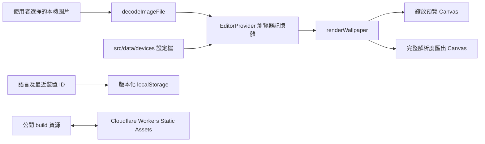

# Wallpect 架構 / Architecture

本文件描述 Wallpect 0.3.0 已實作的系統邊界、資料生命週期及必須維持的工程不變條件。

## 繁體中文

### 執行邊界

Wallpect 是由 Cloudflare Workers Static Assets 提供的單頁應用程式。`wrangler.toml` 沒有 Worker `main` script、API、資料庫或物件儲存 binding。Cloudflare 只傳送公開的 HTML、JavaScript、CSS、service worker 與示範圖片；使用者選擇的圖片只在瀏覽器內解碼、構圖及匯出。

圖中刻意沒有由圖片、Canvas 或 editor state 指向 Cloudflare 的資料路徑。新增這類路徑屬架構與私隱邊界變更，必須先更新產品通知、法律／私隱審閱、測試及本文件。

### 模組職責

| 路徑               | 職責                                                             |
| ------------------ | ---------------------------------------------------------------- |
| `src/components`   | UI、輸入控制、裝置預覽及對話框                                   |
| `src/state`        | Editor session state、各裝置／方向的構圖、歷史及 UI announcement |
| `src/core`         | 圖片驗證／解碼、偏好遷移、幾何、渲染及匯出                       |
| `src/data/devices` | UI 以外、經 schema 驗證的裝置設定檔                              |
| `src/i18n`         | 繁體中文預設、簡體中文／英文翻譯及語言偏好                       |
| `public`           | 靜態 headers、service worker、示範圖片及公開資源                 |
| `tests`            | 單元、整合及 production-mode browser contract                    |
| `scripts`          | 不會進入 runtime bundle 的 deterministic quality gate            |

桌面右欄按常用工作流程顯示覆疊、精確輸出／下載，再提供完整裝置資料；格式、檔名與輔助線置於原生 `details` 內作漸進揭露。流動版預設顯示「調整」，只有使用者成功選圖或選擇裝置的事件才會把分頁帶回「調整」，移除圖片則返回「圖片」。這些導覽與揭露狀態只屬目前頁面的 UI，不得持久保存、改變構圖，或建立另一套匯出邏輯。

### 必須維持的不變條件

1. 預覽與匯出均呼叫 `renderWallpaper`；構圖平移採用目標 Canvas 的標準化座標，因此相同比例的預覽與完整輸出保持一致。快速定位及內容定位亦只可更新同一組標準化 transform，並進入相同歷史，不得建立另一套位置狀態；內容定位只可從旋轉後的渲染邊界計算可用對齊點，不得讀取或分析圖片像素。原始構圖比較只可替換預覽傳入的 transform，匯出仍必須使用目前編輯 transform；專注預覽只可改變工作區版面，不得另建渲染或匯出狀態。「構圖概況」只可從目前圖片、畫布及 transform 衍生裁切與放大倍率；放大倍率必須使用 `renderWallpaper` 共用的幾何計算，不得分析像素、持久保存結果或改變 renderer 輸入。
2. 每個裝置與方向的構圖歷史最多保存 50 步；連續拖曳、捏合、滾輪、滑桿或數值輸入只可提交為一個有意義的步驟。更換或移除圖片必須清除所有裝置與方向的 transform 及歷史，讓新圖片從預設構圖開始。
3. 匯出 Canvas 只在操作期間存在，完成後會縮回 `1 × 1`；下載與上傳建立的 Object URL 必須撤銷。
4. 圖片 bytes、檔名、Canvas 像素、thumbnail URL、transform 及構圖歷史不得寫入 `localStorage`、Cache Storage、網絡請求或分析服務。本機縮圖只可使用上傳時建立的 `blob:` URL；內建示範則使用同源靜態 URL。
5. 可持久保存的資料只有 `wallpect:locale:v1` 及最多四個有效裝置 ID 的 `wallpect:recent-devices:v1`。舊 storage key 及 0.3.0 前的個別型號 ID 會在讀取時清理、映射到標準配置、去除重複並寫回。
6. 裝置資料留在 `src/data/devices`；具名型號只可在完整 wallpaper 幾何相同時合併，推算或估算的幾何不得標示為 `verified`。
7. 缺少的離線導覽可回退到已快取的 `/`，但缺少的 script、style 或其他非導覽資源必須失敗，不得回傳 HTML shell。

### 資料生命週期

| 資料                 | 建立                                 | 保留                                             | 清除／更新                                   |
| -------------------- | ------------------------------------ | ------------------------------------------------ | -------------------------------------------- |
| 使用者圖片及縮圖     | `decodeImageFile` 由本機 `File` 解碼 | React state、瀏覽器圖片物件及暫時 `blob:` URL    | 更換、移除、重新整理或關閉頁面時釋放         |
| 構圖、歷史與匯出設定 | 使用者操作                           | 目前頁面的 React state                           | 更換／移除圖片時重設；重新整理或關閉時清除   |
| 語言                 | 使用者切換                           | `wallpect:locale:v1`                             | 改寫或清除網站資料                           |
| 最近裝置             | 使用者選擇裝置                       | `wallpect:recent-devices:v1`，最多四個有效 ID    | 改寫或清除網站資料                           |
| 公開 app shell       | 首次 production 載入                 | `wallpect-v4` Cache Storage 及一般 browser cache | 新 cache 版本啟用時移除舊 `wallpect-*` cache |

### 驗證門檻

- `npm run check`：strict TypeScript build、lint、單元／整合測試及 raw build budget。
- `npm run format:check`：格式驗證。
- `npm run worker:check`：Static Assets dry-run，不部署。
- `npm run test:e2e`：以 production build／preview 驗證 Chromium、WebKit、Edge 及 Firefox 對應流程。
- E2E 必須覆蓋 PNG／JPEG／WebP 精確尺寸、上傳後零 HTTP(S) egress、Object URL 釋放、離線導覽、鍵盤與內容定位、1280×720 首屏下載可見度、流動版流程銜接與無水平溢出，以及法律／私隱入口。

## English

### Runtime boundary

Wallpect is a single-page application served by Cloudflare Workers Static Assets. `wrangler.toml` has no Worker `main` script, API, database, or object-storage binding. Cloudflare serves only public HTML, JavaScript, CSS, the service worker, and the bundled sample. A user-selected image is decoded, composed, and exported only in the browser.

The diagram above intentionally has no data path from the selected image, Canvas, or editor state to Cloudflare. Adding one is an architecture and privacy-boundary change that requires updated product notice, legal/privacy review, tests, and this document before merge.

### Module ownership

| Path               | Responsibility                                                                              |
| ------------------ | ------------------------------------------------------------------------------------------- |
| `src/components`   | UI, input controls, device previews, and dialogs                                            |
| `src/state`        | Editor session state, per-device/orientation composition/history, and announcements         |
| `src/core`         | Image validation/decoding, preference migration, geometry, rendering, and export            |
| `src/data/devices` | Schema-validated device profiles outside UI components                                      |
| `src/i18n`         | Traditional Chinese default, Simplified Chinese/English translations, and locale preference |
| `public`           | Static headers, service worker, sample image, and public assets                             |
| `tests`            | Unit, integration, and production-mode browser contracts                                    |
| `scripts`          | Deterministic quality gates excluded from the runtime bundle                                |

The desktop `DeviceSelector` may collapse its catalogue after a selection so the adjacent
composition controls remain reachable without scrolling through every device. The mobile device
tab uses the same data and search component in its expanded form. This presentation state is local
to each component instance and must not enter editor persistence or alter the selected profile.

The mobile workspace may switch between balanced and control-priority grid rows. This UI-only state
lives in `Workspace`, changes only the available preview and panel heights, and must not alter or
persist the image, transform, selected profile, export settings, or renderer inputs. The control is
a labelled native button; a decorative drag handle must not imply unsupported resizing.

The desktop right rail follows the common path from overlays to exact output/download, then detailed
device data; format, filename, and guide controls use native `details` for progressive disclosure.
Mobile opens on Adjust. Only a successful user image/device selection event may return the active tab
to Adjust, while image removal returns to Image. These navigation and disclosure states are session UI
only: they must not persist, alter a composition, or create a second export path.

### Required invariants

1. Preview and export both call `renderWallpaper`. Pan values use normalized target-Canvas coordinates, preserving a composition between an aspect-matched preview and full output. Quick and content positioning may update only that same normalized transform and must enter the same history; neither may create a second position state. Content alignment may derive useful anchors only from the rotated render bounds and must not read or analyse image pixels. Original-composition comparison may replace only the preview transform; export must continue using the active edited transform. Focus preview may change only workspace layout and must not create separate rendering or export state. Composition check may only derive crop and enlargement from the active image, canvas, and transform. Enlargement must use geometry shared with `renderWallpaper`; it must not inspect pixels, persist results, or alter renderer inputs.
2. Each device-orientation composition history retains at most 50 steps. Continuous drag, pinch, wheel, slider, or number-input edits must commit as one meaningful step. Replacing or removing an image must clear transforms and histories for every device and orientation so the next image starts from its default composition.
3. The export Canvas exists only for the operation and is reduced to `1 × 1` afterward. Object URLs created for uploads and downloads must be revoked.
4. Image bytes, filenames, Canvas pixels, thumbnail URLs, transforms, and composition history must not enter `localStorage`, Cache Storage, network requests, or analytics. A local thumbnail may use only the upload's `blob:` URL; the bundled sample uses a same-origin static URL.
5. Persisted data is limited to `wallpect:locale:v1` and up to four valid device IDs in `wallpect:recent-devices:v1`. The legacy storage key and pre-0.3.0 per-model IDs are sanitized, mapped to canonical configurations, deduplicated, and written back when read.
6. Device data stays in `src/data/devices`; named models may be consolidated only when their complete wallpaper geometry matches, and derived or estimated geometry must not be labelled `verified`.
7. An unavailable offline navigation may fall back to cached `/`. A missing script, style, or other non-navigation asset must fail and must not receive the HTML shell.

### Data lifecycle

| Data                                | Created                                          | Retained                                              | Cleared or updated                                         |
| ----------------------------------- | ------------------------------------------------ | ----------------------------------------------------- | ---------------------------------------------------------- |
| Selected image and thumbnail        | Decoded from a local `File` by `decodeImageFile` | React state, browser image, and temporary `blob:` URL | Replace, remove, refresh, or close                         |
| Composition/history/export settings | User interaction                                 | Current-page React state                              | Reset on replace/remove; clear on refresh or close         |
| Locale                              | User selection                                   | `wallpect:locale:v1`                                  | Overwrite or clear site data                               |
| Recent devices                      | Device selection                                 | `wallpect:recent-devices:v1`, up to four valid IDs    | Overwrite or clear site data                               |
| Public app shell                    | First production load                            | `wallpect-v4` Cache Storage and normal browser cache  | Old `wallpect-*` caches removed when a new cache activates |

### Verification gates

- `npm run check`: strict TypeScript build, lint, unit/integration tests, and the raw build budget.
- `npm run format:check`: formatting validation.
- `npm run worker:check`: Static Assets dry-run without deployment.
- `npm run test:e2e`: production build/preview coverage across the mapped Chromium, WebKit, Edge, and Firefox flows.
- E2E must cover exact PNG/JPEG/WebP dimensions, zero HTTP(S) egress after upload, Object URL release, offline navigation, keyboard and content positioning, first-view download visibility at 1280×720, mobile workflow handoff and overflow, and legal/privacy entry points.
